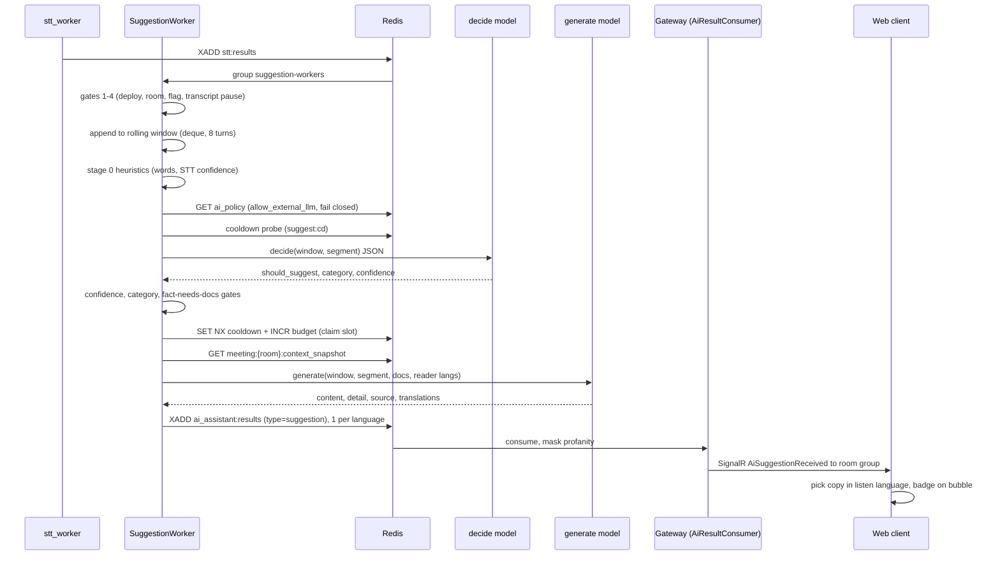

# 09 - Live Meeting Assistant: Inconsistency and Follow-up Suggestions

Sources (read-only, shallow clones): `WarpTalk-CapstoneProject/warptalk-ai` @ `d0db9b9`, `warptalk-backend` @ `c51b39b` (sparse), `warptalk-web` @ `e1dd35d` (sparse, `src/` only).
Paths are relative to warptalk-ai unless prefixed `backend:` or `web:`. Line numbers refer to those commits. Normative words follow RFC 2119. No secrets, keys or hostnames are reproduced. Latency of the translation/TTS path is in [08-realtime-latency.md](08-realtime-latency.md); the translation and voice models are in [13-voice-clone-and-translation-models.md](13-voice-clone-and-translation-models.md).

## 1. Goal and verdict

The product goal: while a meeting is live, the AI listens to the transcript and pops up (a) inconsistency hints (contradictions with earlier speech or workspace documents, wrong numbers or dates, unrealistic commitments) and (b) follow-up hints (action item: who, what, deadline).

| Goal | Live today? | Where |
|---|---|---|
| (a) Contradiction with earlier in-meeting speech | Yes, one-shot LLM judgement | category `correction`, `suggester.py:33,175` |
| (a) Contradiction with workspace documents | Partial: only via `fact`/`correction` against the full document snapshot, no retrieval | section 5 |
| (a) Wrong number/date, unrealistic commitment | Partial: only if it contradicts the window or a document; no arithmetic or feasibility check | section 11 |
| (b) Commitment missing owner/deadline | Yes, hint only (`action`), nothing stored | `suggester.py:35,177` |
| (b) Structured action item (owner, due date, source segment) | Post-meeting only, from approved minutes or WarpBot chat | section 7 |
| Accept an item from a live hint | Manual, via WarpBot prompt; no one-click accept | section 9 |

The agent is `suggestion_worker` (`suggestion_worker/worker.py:1-15`). Hints are ephemeral; nothing is persisted by it (`worker.py:14`).

## 2. End-to-end flow



Stage order and references (`SuggestionWorker.process`, `worker.py:253-400`):

```
stt:results -> gates -> window append -> stage 0 (worker.py:411) -> cap/consent/cooldown (326-340)
  -> decide (suggester.py:438) -> confidence/category/fact gates (346-385)
  -> claim slot (worker.py:515) -> generate (suggester.py:481) -> publish (worker.py:582)
```

## 3. Trigger conditions (gates, in order)

| # | Gate | Behaviour |
|---|---|---|
| 1 | `SUGGESTION_ENABLED` | Deploy ceiling; default `false` (`worker.py:256`) |
| 2 | Room active | Not paused and route state not in PAUSED, ENDED, FAILED, CANCELLED, TIMEOUT (`worker.py:54,406`) |
| 3 | `flags.ai_suggest` | Platform flag per workspace; can only narrow gate 1 (`_flag_allows`, `worker.py:239`) |
| 4 | Transcript not paused | Host-paused speech is skipped BEFORE the window, so it never reaches a prompt (`worker.py:276-301`) |
| 5 | Stage 0 heuristics | Non-empty, word floor, STT confidence floor (section 4) |
| 6 | Cap not zero | `max_per_meeting <= 0` disables (`worker.py:326`) |
| 7 | External-LLM consent | Section 8; fail closed (`worker.py:330`) |
| 8 | Cooldown inactive | Read-only probe (`worker.py:338`) |

Every segment that passes gate 4 enters the window, even if rejected at gate 5, since a short line can give the next one meaning (`worker.py:303-309`). `is_final_chunk` MUST NOT be a gate: on this stream it marks an empty end-of-chunk marker (`worker.py:419-423`).

## 4. Inputs and stage 0

| Input | Source | Used by |
|---|---|---|
| Segment | `STTResultMessage`: meeting_id, segment_id, speaker_id, text, language, confidence (`worker.py:259-265`). Source-language text, not translated. | both stages |
| Window | In-memory `deque(maxlen=window_size)` per room, default 8 turns, current segment excluded (`worker.py:197,305,343`). Dropped in `_cleanup_room` (`worker.py:206-214`). | both |
| Document snapshot | Redis `meeting:{room}:context_snapshot` (`_context_snapshot`, `worker.py:551`); fetched only after decide passes | generate only |
| Reader languages | Redis hash `translationRoom:{room}:languages` minus segment language, max 4 (`worker.py:563,64`) | generate only |

The window carries `speaker_id` (user id) and `language` per turn (`TranscriptTurn`, `suggester.py:44`); it has no timestamps and no resolved speaker display names.

Stage 0 (`_passes_local_heuristics`, `worker.py:411-462`, no tokens):
- Empty text rejected.
- Word floor `min_question_words` (2) if `_looks_like_question` (trailing `?`/`？` or a Vietnamese or English interrogative at the edges, `worker.py:71-131`), else `min_words` (4). Question detection only selects the floor.
- STT confidence is an average token logprob (<= 0). Rejected if not the sentinel `-1.0` and below `min_stt_confidence`. The sentinel MUST pass, else the feature silently dies when logprobs are absent (WT-543, `worker.py:443-461`).

## 5. Categories, detection and grounding

Closed whitelist `SUGGESTION_CATEGORIES` (`suggester.py:33-41`); the same five are rendered by the client (`web: suggestion-badge.tsx:27-49`). An unknown category is dropped and logged at WARNING (`worker.py:364`).

| Category | Decide prompt fires when (paraphrase) | Goal | Grounding |
|---|---|---|---|
| `correction` | Segment contradicts earlier transcript "including numbers, dates, names and decisions that changed", or misstates a well-established public fact (high bar) (`suggester.py:175`) | (a) inconsistency | Window (8 turns) only; public knowledge for the second kind |
| `fact` | A figure, name or reference discussed that the meeting's documents cover (`suggester.py:179`) | (a) partial (surfaces document truth, does not itself flag a conflict) | Full document snapshot; declined when snapshot empty (`worker.py:380`) |
| `action` | Commitment, plan or promise missing an owner, a date, or both (`suggester.py:174`) | (b) follow-up | Window; nothing stored |
| `clarification` | A question was asked that the transcript does not answer, with or without `?` | neither (supporting) | Window |
| `term` | Jargon, acronym or product used without definition | neither (supporting) | Window, documents, or general knowledge |

Key prompt instructions (quoted fragments, paraphrase otherwise):
- Decide is told to judge, not abstain: "let your confidence carry how sure you are" (`suggester.py:187`). The rationale for removing earlier abstain language is documented above the prompt (`suggester.py:139-160`).
- Generate contract for `correction`: "State both sides" of the contradiction; the earlier statement must be quoted; correct "the FACT, never the person" (`_CATEGORY_CONTRACTS`, `suggester.py:233`).
- Generate contract for `action`: name what is missing; "Do not invent either one." (`suggester.py:229`).
- Meeting-specific facts "must come from the transcript or the supplied documents"; an invented name, number, date or owner is "worse than silence" (`suggester.py:288-296`). Empty `content` is a valid answer.
- `source` is `""` (transcript), a document name copied from the `--- Document: ... ---` header, or `"general knowledge"` for `term` and `correction` only (`suggester.py:297-322`). Unknown document names are discarded (`_known_documents`, `suggester.py:330-344`).

How contradictions are grounded today:

| Source | Mechanism | Status |
|---|---|---|
| In-meeting history | Rolling 8-turn window in memory, rendered into both prompts (`_render_transcript`, `suggester.py:366`) | Live. Contradictions older than 8 turns are invisible. |
| Workspace documents | The whole extracted text of all meeting documents, concatenated with `--- Document: <name> ---` headers, stored under `meeting:{room}:context_snapshot` with a 24 h TTL at `meeting.started` (`backend: workspace/.../BackgroundServices/MeetingStartedEventConsumer.cs:150-172`), appended to the generate user message inside `<reference_documents>` (`suggester.py:498-501`) | Live, but full-text stuffing: no retrieval, no ranking. A size cap on the snapshot was not found; very large document sets would hit the model context. |
| `knowledge_facts` / embedding search | `ai_assistant_worker/knowledge_facts.py` extracts durable facts in six categories (decision, requirement, definition, commitment, risk, reference), max 12 per content (`knowledge_facts.py:36-48`) and `knowledge_fact_worker.py` publishes them to `embedding:index_requests`. `suggestion_worker` does NOT query this index (grep for knowledge/embedding/vector in `suggestion_worker/` finds none). | Not connected |
| Citations | Only document names found in the snapshot headers; emitted as `sources_json` `[{marker:"S<n>", kind:"document", title}]` (`worker.py:588-609`). No quote offsets or segment ids. | Document-level only |

## 6. Prompt-injection and output hygiene

- Transcript is fenced in `<transcript>` and both prompts carry `_UNTRUSTED_INPUT_RULE` (`suggester.py:137`).
- Documents go into the user message, not the system prompt (`suggester.py:498-501`).
- Model output is never used raw: boolean, whitelisted category, clamped float, length-capped string, source matched to known headers (`suggester.py:332-344, 536-540`).

## 7. Action items and follow-up: where they exist today

There is no live structured action-item extraction. Three separate paths exist; only the first is live.

| Path | Trigger | Output | Reference |
|---|---|---|---|
| Live `action` hint | Per segment, gated as above | Ephemeral badge naming the missing owner/deadline; no schema beyond `SuggestionResultMessage` | `suggester.py:35,229` |
| Post-meeting extraction | `__MEETING_END__` marker or on-demand (`ai_assistant_worker/worker.py:56,146`) | Markdown checklist `[ ] item - @assignee` published as `type=action_items` (`worker.py:491-512`, prompt `assistant.py:50-60`, `extract_action_items` at `assistant.py:120`, temperature 0.2), plus structured `actionItems: [{task, owner, atMs}]` inside the summary JSON (`summary_templates.py:98-106,304-307`, `assistant.py:162-270`) | Post-meeting |
| Persisted rows | Approving minutes, or WarpBot tool `create_action_item` | Table `translation_room.meeting_action_items` | below |

Post-meeting extraction rules: "Only include explicit commitments, not vague suggestions" (`assistant.py:60`); owner left empty when not said, "Do not invent an owner" (`summary_templates.py:103-105`); "Include any deadline that was spoken", but the structured shape has no deadline field (`summary_templates.py:306`). Spoken deadlines therefore live only in the task text.

Persisted schema (`backend: translation-room/database/migrations/20260820160000_meeting_action_items.sql`, `20260923090000_action_items_from_assistant.sql`):

| Column | Meaning |
|---|---|
| `task` (text, max 1000), `owner_name` (varchar 200) | What the meeting said; never overwritten |
| `owner_participant_id`, `assignee_user_id` | Resolved owner; NULL when ambiguous (`ActionItemOwnerResolver`) |
| `at_ms` | Source segment position (citation); NULL for assistant-created rows |
| `due_date` | Date, set manually or inherited from a prior revision; not parsed from speech |
| `status` | `OPEN`, `DONE`, `DROPPED` (`MeetingActionItemConstants.cs`) |
| `source`, `source_minutes_id`, `created_by` | `MINUTES` (requires minutes id) or `ASSISTANT` (no minutes, caller id); check constraint keeps them consistent |
| `series_id` | Denormalised for carry-over across a recurring series (read-through, no copy) |

Creation: rows are materialised only on minutes approval (`MeetingMinutesService.ApproveAsync` -> `MaterialiseActionItemsAsync`, `backend: MeetingMinutesService.cs:697-730,1315-1375`), idempotent on `source_minutes_id`, a revision inherits status and due date by `at_ms`, and the assignee gets an `ACTION_ITEM_ASSIGNED` notification (`:29,1393-1415`). Drafts never create tasks, by design. API: `GET/POST rooms/{roomId}/action-items`, `GET workspaces/{workspaceId}/action-items/mine`, `PUT action-items/{itemId}/status`; only the assignee or host may close (`MeetingActionItemsController.cs:32-82`, `ErrorUnauthorizedClose`).

Dedup: none among live hints (section 10). For persisted items, idempotency per minutes id and `at_ms` matching on revision; no text-similarity dedup.

## 8. Privacy, consent and DLP

| Control | Behaviour | Reference |
|---|---|---|
| External-LLM consent | Redis `translationRoom:{room}:ai_policy` JSON `allow_external_llm`, written by the gateway from the workspace directory policy (`backend: gateway/.../AiResultConsumerService.cs:385-405`); a missing or unreadable key means no model call. Cached 60 s per room so a revoke applies mid-meeting. Checked BEFORE any text leaves the process. | `_external_llm_allowed`, `worker.py:468-498,330` |
| Transcript pause | Paused speech never enters the window or a prompt | `worker.py:276-301` |
| Profanity | Gateway masks `content` and `detail` when the workspace filter is on | `backend: AiResultConsumerService.cs:1256-1268` |
| Length | `content` truncated to `max_suggestion_chars` (140) | `worker.py:588-591` |
| security_worker | Scans uploaded documents (stream `security:scan_requests`, keyword blacklist plus regex PII masking for email/phone/card) (`security_worker/worker.py:78`, `regex_scanners.py:56`). It is NOT on the `stt:results` path: live transcript text sent to the LLM is not PII-scrubbed. | gap |

Sensitivity dials: the workspace has an on/off (`flags.ai_suggest` allow/deny list) and the consent boolean. Thresholds are platform-wide (operator), not per workspace (section 12).

## 9. Delivery and UI contract

Message `SuggestionResultMessage` (`shared/schemas.py:1113-1149`):

| Field | Meaning |
|---|---|
| `meeting_id`, `segment_id` | Room and STT segment the badge pins to |
| `type` | constant `"suggestion"` |
| `category` | one of five |
| `content` | badge text, <= 140 chars |
| `detail` | expanded evidence (quote, earlier statement, document) |
| `confidence` | decide-stage confidence |
| `language` | language of this copy |
| `token_count` | decide plus generate tokens (translated copies 0) |
| `sources_json` | document chips |
| `timestamp_ms` | epoch ms |

Delivery chain:
1. `publish("ai_assistant:results", ...)` writes to the per-meeting and global streams (`shared/base_worker.py:818-842`; `worker.py:609`).
2. One extra copy per reader language with translated content/detail, same segment id (WT-922, `worker.py:611-629`).
3. Gateway consumes, routes `type="suggestion"` before the legacy summary branch, drops entries lacking `segment_id`/`content`, and sends SignalR `AiSuggestionReceived` to group `translationRoom:{roomId}` (`backend: AiResultConsumerService.cs:1252-1273`). DTO `AiSuggestionDto` (`backend: gateway/.../Hubs/HubModels.cs:133-160`): `TranslationRoomId, SegmentId, Category, Content, Detail, Confidence, Language, CreatedAt, SourcesJson`.
4. Client handler `connection.on("AiSuggestionReceived")` calls `addSuggestion(s, targetLanguage)` (`web: persistent-meeting-session.tsx:4064-4072`). Store `suggestions: Record<segmentId, dto>`, one per segment; a copy in the listener's language replaces one that is not (`web: translationRoom-store.ts:91-95,507-520`); `dismissSuggestion(segmentId)` removes it (`:524-532`). Not persisted: gone after reload (`web: types/realtime.ts:185`).
5. Rendering: `findSuggestionForUtterance` maps the segment to its merged bubble (`web: lib/transcript/transcript-display.ts:279`, `transcript-panel.tsx:389`). A category icon badge (`suggestion-badge.tsx:27-31`) toggles a detail panel with evidence, source chips, a "may be wrong" disclaimer, a dismiss button, and category-specific follow-up buttons that send a prompt to WarpBot (`web: lib/meeting/suggestion-actions.ts`): term: research, find in documents, draft glossary entry; clarification: ask, find who knows; correction: `checkWhichIsRight`; action: `draftTask` ("Turn this into a task with a clear owner and a deadline") and plan execution.

Accepting an action hint is therefore "ask WarpBot", which can call `_create_action_item` (`chat_tools.py:1877`; owners `ME`/`NAMED`/`NONE`, resolved server-side, refused when ambiguous) and create an `ASSISTANT` row. No accept/reject feedback is sent back to the worker.

## 10. Rate limiting, cost control, models

| Control | Mechanism | Reference |
|---|---|---|
| Confidence gate | `decide.confidence < min_confidence` (0.55) dropped | `worker.py:357` |
| `fact` needs documents | Empty snapshot declines `fact` (WT-371) | `worker.py:380` |
| Cooldown | Redis `suggest:cd:{room}` SET NX, TTL `cooldown_seconds`; probed before decide, claimed after decide passes and before generate (cross-replica) | `worker.py:505,512,530` |
| Budget | Redis `suggest:n:{room}` INCR, TTL `state_ttl_seconds`; over `max_per_meeting` dropped | `worker.py:509,538-544` |
| Dedup | None textual; relies on cooldown, budget, "already explained" in decide prompt, "never restate" in generate | `suggester.py:183-185,295` |

A claimed slot is burnt even if generate returns nothing; cooldown default was lowered to 20 s for that reason. Limits live in Redis because replicas share one consumer group (`worker.py:518-522`).

Cost shape: decide (cheap, 64 tokens) runs on every segment surviving stage 0 (the code comment estimates about 150 per meeting, `suggester.py:3`); generate only on the few that pass. Provider is OpenAI chat completions with JSON mode for both stages (`suggester.py:444-457,504-520`); models and reasoning effort pass through `shared.openai_options.completion_options`. Billing: tokens roll into one AI_ASSISTANT usage record by billing_worker.

## 11. Multilingual handling

- Detection runs on the speaker's source-language text (`STTResultMessage.language`), not on any translation. A speaker in Vietnamese is judged in Vietnamese; mixed-language contradictions rely on the model.
- The hint is written in the segment language, and the same generate call returns `translations` keyed by each reader language (max 4 codes, `_translations_rule`, `suggester.py:244-268`). Quotes from the transcript are translated too; names, terms and figures stay as spoken.
- Translated copies are separate stream entries (`token_count=0`); the client keeps the copy for its listen language and falls back to any copy so a single-language room still sees one (`web: translationRoom-store.ts:496-520`).
- Malformed or missing translation: that reader loses only its copy (`suggester.py:347-363`); reader-language read failure: speaker-language hint still published (`worker.py:572-574`).
- Generate token cap scales as `200 x (1 + languages)` to avoid truncated JSON (`suggester.py:510-518`).

## 12. Configuration knobs

Env prefix `SUGGESTION_` (`shared/config.py:984-1075`). Five thresholds are operator-tunable live via platform settings (read per segment, env fallback; `worker.py:225-237`, `shared/platform_settings.py:101-105`).

| Env | Default | Platform key (range) |
|---|---|---|
| `SUGGESTION_ENABLED` | `false` | deploy ceiling |
| `SUGGESTION_DECIDE_MODEL` / `GENERATE_MODEL` | `gpt-4o-mini` / `gpt-4.1` | n/a |
| `SUGGESTION_DECIDE_MAX_TOKENS` / `GENERATE_MAX_TOKENS` | 64 / 200 per language | n/a |
| `SUGGESTION_TEMPERATURE`, `REASONING_EFFORT` | 0.2, `none` (gpt-5 family only) | n/a |
| `SUGGESTION_REQUEST_TIMEOUT_SECONDS` | 8.0, `max_retries=0` | n/a |
| `SUGGESTION_MIN_CONFIDENCE` | 0.55 | `meetings.ai_suggest.min_confidence` (0-1) |
| `SUGGESTION_COOLDOWN_SECONDS` | 20 | `...cooldown_seconds` (0-600) |
| `SUGGESTION_MAX_PER_MEETING` | 30 | `...max_per_meeting` (0-200; 0 disables) |
| `SUGGESTION_STATE_TTL_SECONDS` | 14400 | n/a |
| `SUGGESTION_MIN_WORDS` / `MIN_QUESTION_WORDS` | 4 / 2 | `...min_words` (1-20) |
| `SUGGESTION_MIN_STT_CONFIDENCE` | -0.5 | `...min_stt_confidence` (-5 to 0) |
| `SUGGESTION_WINDOW_SIZE` | 8 | n/a |
| `SUGGESTION_MAX_SUGGESTION_CHARS` | 140 | n/a |
| (flag) `flags.ai_suggest` | on | per-workspace allow/deny list |

Code defaults only; production overrides were not determined.

## 13. Failure handling

- Both model calls degrade to silence: any exception returns decline or `None`, so the message is not redelivered and not billed twice (`suggester.py:384-391,459-461,522-524`).
- 8 s timeout, no SDK retries: a late hint is worthless (`suggester.py:420-430`).
- `NullSuggester` is the default when disabled: worker consumes and declines, no API key needed (`suggester.py:106`, `suggestion_worker/__main__.py`). Enabled without a key is a hard startup failure (`suggester.py:416-418`).
- Empty `content` after generate is not published (`worker.py:397`).

## 14. Relation to ai_assistant_worker

| Aspect | suggestion_worker | AIAssistantWorker (summary) | ChatAssistantWorker (WarpBot) |
|---|---|---|---|
| Group | `suggestion-workers` | `assistant-workers` (`worker.py:80-85`) | `assistant-chat-workers` (`chat_worker.py:669-674`) |
| Input | `stt:results` | `stt:results` buffered (`transcript_buffer.py`) | `assistant:chat_requests` |
| Trigger | Every segment, gated | Meeting end or on demand | User question |
| Output | `type=suggestion` | summary, action_items, structured JSON | `assistant:chat_results` |

Shared: the `context_snapshot` key, the `sources_json` chip shape, the `ai_assistant:results` stream (split by `type`), the transcript-pause flag.

## 15. Gap analysis and recommended additions

Exists: gated two-stage live detector with in-window contradiction and missing-owner/date hints; document-grounded `fact`; multilingual copies; consent fail-closed; Redis cooldown/budget; post-meeting action items and persisted task rows with owner resolution, status and carry-over.

Partial:
1. Document contradictions rely on full-text stuffing; no retrieval, so large corpora truncate or dilute, and `correction` is not told to compare against documents (its prompt speaks of "earlier in the transcript").
2. Window of 8 turns; a number stated 20 minutes ago is forgotten.
3. Wrong numbers/dates are caught only as contradictions, not as arithmetic or calendar errors.
4. `action` hints identify missing owner/date but carry no structured fields.

Missing:
5. Live structured action items (owner, due date, source segment) and a one-click accept.
6. Unrealistic-commitment detection (dates in the past, impossible sums, overcommitted owner).
7. Hint feedback loop (dismiss/accept metrics) and per-workspace sensitivity.
8. PII/DLP scrub on live transcript before the external LLM.

Recommended design (proposal):

- (proposal) **Claim ledger.** Keep a per-room Redis list/stream of extracted claims (`{segment_id, speaker_id, kind: number|date|decision|commitment, subject, value, unit, ts}`) written by a cheap extractor (can be folded into the existing decide call by adding a `claims[]` field). New segments are compared against the ledger by subject, not by recency, which removes the 8-turn blind spot at a bounded token cost. TTL = `state_ttl_seconds`.
- (proposal) **Retrieval-grounded `fact`/`correction`.** At generate time, query the existing embedding index (the one fed by `knowledge_fact_worker`, categories decision/requirement/commitment/risk) with the claim text, top-k 3 chunks, and pass those instead of the full snapshot; return chunk ids as citations (`marker`, `kind: "knowledge_fact"`, `title`, `chunk_id`). Add a `conflict` flag to the generate contract so `correction` can cite documents explicitly.
- (proposal) **Typed `action` payload.** Extend `SuggestionResultMessage` with optional `action_item: {task, owner_name, owner_user_id?, due_date?, due_text, source_segment_id}`; generate fills it from transcript only (never invented; `due_text` verbatim, `due_date` parsed server-side against the meeting date and speaker timezone, ambiguous stays null). Keep `content` as the badge text.
- (proposal) **Accept/dismiss API.** Gateway hub method `AcceptSuggestion(segmentId, edits)` calls `POST rooms/{roomId}/action-items` with `source=ASSISTANT` (owner resolved by `ActionItemOwnerResolver`); `DismissSuggestion(segmentId, reason)` is logged for tuning. Accepting is idempotent per `(room, segment_id)`; extend the row with `source_segment_id` and a unique index to give real dedup against the post-meeting extraction (match on `at_ms`).
- (proposal) **Feasibility checks.** Deterministic pre-pass in stage 0 for dates (past date, weekend/holiday for the room's locale) and sums; only matches go to the decide model with the finding prefilled, saving tokens and raising precision.
- (proposal) **Workspace dials.** Add workspace-level overrides for `min_confidence`, `cooldown_seconds`, per-category enable list (`inconsistency`, `follow_up` presets) stored with the workspace directory policy and projected into Redis next to `ai_policy`.
- (proposal) **Live DLP.** Run `scan_and_mask_regex_pii` (`security_worker/regex_scanners.py:56`) on window text before prompting; masking costs no tokens.
- (proposal) **Hint text dedup.** Hash `(category, normalised subject)` per room with the budget TTL to suppress a repeated contradiction on the same claim.

## 16. Not determined

- Production env overrides and platform settings values.
- Snapshot size cap and whether the model context truncates large document sets.
- Whether any client-side dedup of repeated badges exists beyond one-per-segment.
