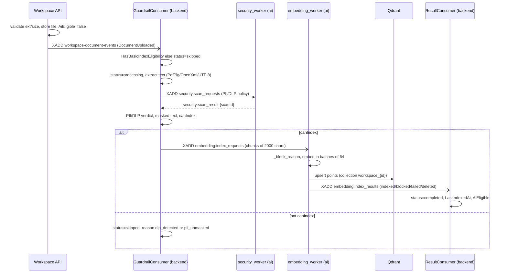

# 14 - Workspace Knowledge and RAG

Sources (read-only, shallow clones): `WarpTalk-CapstoneProject/warptalk-ai` @ `d0db9b9`, `warptalk-backend` @ `c51b39b` (sparse: workspace, assistant, translation-room, transcript, contracts, database).
Paths are relative to warptalk-ai unless prefixed `backend:`. Line numbers refer to those commits. No secrets, keys or hostnames are reproduced. Items marked "(proposal)" are not implemented. "Inferred" means derived from code reading, not a test run.

## 1. Scope and architecture in one paragraph

Workspace knowledge is a single Qdrant collection per workspace, `workspace_{workspaceId}`, plus one shared collection `global_glossary`. The **backend** (workspace, transcript, translation-room services) extracts, scans and chunks content and publishes `embedding:index_requests`. The **warptalk-ai** `embedding_worker` embeds and upserts; the same worker answers `embedding:search_requests`. The assistant worker (`ai_assistant_worker`) is the main reader and enforces access scope before calling the search worker. Access control is a query-time allowlist filter, not a payload ACL.

## 2. Knowledge sources and when each is indexed

| Source | `source_type` | Producer (code) | Trigger | Chunking | Scan |
|---|---|---|---|---|---|
| Uploaded document (pdf, docx, xlsx, md) | `document` | `backend:DocumentSecurityGuardrailConsumerService` then `RedisEmbeddingIndexPublisher` (lines 12-100) | `DocumentUploaded` event; also `IsAiAllowed` false-to-true and revision upload | Fixed 2000-char slices, trimmed, no overlap (`EmbeddingChunkCharLimit`) | PII + DLP (section 3) |
| Transcript segment | `transcript` | `backend:TranscriptRedisConsumerService.PublishEmbeddingIndexRequestAsync` (1428-1470) | Each persisted segment (~608) | One segment = one chunk; text `[{speaker}] {text}` | None; `ai_retrieval_allowed` always `true` |
| Meeting summary / minutes | `meeting_summary` | `backend:SummaryResultConsumerWorker.ReindexSummaryAsync` (427-450, called 229) via `RedisKnowledgeFactRequestPublisher` | Summary rewrite only. Initial-summary indexing path not found in the checked-out files (unverified) | Content chunk + fact chunks (section 6) | None |
| Knowledge fact | `meeting_summary` / `document`-typed fact chunks | `knowledge_fact_worker.py` | `knowledge:fact_requests` | One chunk per fact | `external_llm_allowed` gate |
| Workspace glossary term | `glossary_term` | `backend:GlossaryService.TryPublishEmbeddingIndexRequestAsync` (498; delete 578) | Term create/update/delete (210, 476) | One term = one chunk; `ai_retrieval_allowed` = `IsActive` | None |
| Global glossary term | `global_glossary_term` | `backend:GlobalGlossaryService` (`GlobalCollectionId="global_glossary"`, workspace sentinel `"global"`, `MaxPublishedTerms=200` line 28) | Publish; delete on archive/delete (418-449) | One term = one chunk | None |

Images (png, jpg, jpeg, webp, bmp, gif) are uploadable but not AI-readable; there is no OCR (`backend:WorkspaceDocumentConstants`). AI-readable extensions: pdf, docx, xlsx, md. Upload sets `effectiveIsAiAllowed = request.IsAiAllowed && IsAiReadableExtension` (`WorkspaceDocumentService` ~418); `AiEligible` starts false.

## 3. Ingestion pipeline

### 3.1 Redis streams and keys

| Name | Type | Group / consumer | Notes |
|---|---|---|---|
| `workspace-document-events` | stream | `workspace-document-ingestion` (backend), read 5 at a time | Only `DocumentUploaded` handled; group creation retries with backoff 2s doubling to 30s |
| `security:scan_requests` | stream | security worker | Fields `scan_id`, `content`, `pii_enabled`, `dlp_enabled`, `keywords` (JSON) |
| `security:scan_result:{scanId}` | key | TTL `result_ttl_seconds` 300 | Plus pub/sub `security:scan_completed:{id}` |
| `embedding:index_requests` | stream | `embedding-workers`, MAXLEN ~10000 | Concurrency `EMBEDDING_CONCURRENCY` (2) |
| `embedding:index_results` | stream | `workspace-document-embedding-results` (backend) | Dead-letter `embedding:index_results:dead-letter`; retry hash `embedding:index_results:workspace-retries`; MaxAttempts 5; reclaim idle 30s; read count 10 |
| `embedding:search_requests` | stream | `embedding-search-workers` | Reply: RPUSH to `embedding:search_result:{job_id}`, TTL 30s |
| `knowledge:fact_requests` | stream | `knowledge-fact-workers` | MAXLEN 10000, `MaxTextChars` 32000 |
| `assistant:summary_results` | stream | backend `SummaryResultConsumerWorker` | Triggers summary reindex |

### 3.2 Document ingestion sequence

### 3.3 Steps and rules (backend:`DocumentSecurityGuardrailConsumerService`, 640 lines)

1. Missing or deleted document: skip. A pending masked-version rescan takes a separate path.
2. `HasBasicIndexEligibility` false: `ingestion_status=skipped`. Otherwise `processing`.
3. `DocumentTextExtractor`: PdfPig (PDF), OpenXml (DOCX/XLSX), UTF-8 (md). Pages/sheets are retained in the saved extracted-text JSON, but chunking uses `FullText` only. Unreadable: `failed` + `extraction_unreadable`, then a delete event and a lifecycle event.
4. `securityScanner.ScanAsync` with timeout from `SecurityScanBudget.For(length)`. Policy from `AiPolicyResolver`: defaults `piiEnabled=true`, `dlpEnabled=false`, `allowExternalLlm=true` (hard-coded); document `AiUsagePolicy` JSON overrides workspace config.
5. Audit `SecurityScanCompleted`. PII or DLP hit sets `ConfidentialityLevel=restricted`.
6. `canIndex = IsAiAllowed && !wasRestrictedBeforeScan && status==public && retention==active && !Dlp && (!Pii || hasMaskedContent)`. Failure reasons `dlp_detected`, `pii_unmasked`. When PII was detected the masked text is what gets chunked.
7. Publish: null job id gives `skipped`; publish exception gives `failed` + `embedding_publish_failed`. Scan exceptions map to `security_scan_timeout`, `security_scan_failed` or `ingestion_error` (~488-492).
8. Request fields (`schemas.py:22-39`): `job_id` (`{docId:N}:{revision}`), `workspace_id`, `collection_id`, `source_type`, `source_id`, `chunks[{id,text,metadata}]`, `external_llm_allowed`, `ai_retrieval_allowed`, `retention_state`, `deletion_state`, `timestamp_ms`. Chunk id = MD5-derived GUID of `warptalk:{docId:N}:{index}`; metadata `document_id`, `document_name`, `chunk_index`, `ingestion_revision`. No page or segment metadata.

### 3.4 Security worker (`security_worker/worker.py`)

DLP verdict is the local keyword blacklist only (whole word or phrase, case-insensitive; model-claimed hits absent from the text are dropped). PII detection and masking use an OpenAI model. Limits: `max_analyze_length` 20000 per chunk; `max_total_analyze_length` 400000 (scan fails above; mirrored by `backend:SecurityScanBudget.MaxScannedCharacters`); `scan_concurrency` 8. Result JSON: `pii_detected`, `dlp_detected`, `violation_found`, `masked_content`, `scan_failed`, `dlp_flagged_terms`.

### 3.5 Embedding worker (`embedding_worker/worker.py`)

- Deletion (79-84): `deletion_state=="deleted"` deletes by chunk id and publishes `deleted`.
- `_block_reason` (156-166), in order: `ai_retrieval_not_allowed`; `source_not_active` (retention != active); `external_llm_disabled_without_local_embedding_provider`. Result `blocked`.
- Empty chunk list: publishes `indexed` with 0 chunks.
- Batches of `EMBEDDING_BATCH_SIZE` (64); `_validate_dimensions` (168-175) raises on mismatch.
- Point payload (125-139): chunk metadata plus `workspace_id`, `source_type`, `source_id`, `chunk_id`, `text`, `ai_retrieval`, `retention_state`, `deletion_state`, `indexed_at` (epoch ms, one stamp per batch).
- Any exception publishes `failed` with the reason. The worker itself does not retry.
- Result fields: `job_id`, `workspace_id`, `collection_id`, `source_type`, `source_id`, `status` (indexed/blocked/deleted/failed), `chunks_indexed`, `provider`, `model`, `dimensions`, `reason` (published at line 197).
- `QdrantVectorStore._ensure_collection` creates the collection on first upsert (`VectorParams(size=dimensions, distance)`).

### 3.6 Result consumption (`backend:DocumentEmbeddingResultProcessor`, 20-140)

Only `source_type=document` results are handled. `indexed`: set `LastIndexedAt`, `IndexVersion` (provider/model/dimensions), status `completed`, `AiEligible = IsAiAllowed && !restricted && public`; if not `IsIndexEligible` the chunks are deleted again; audit `EmbeddingIndexed`. `blocked`: `skipped` + `embedding_blocked`. `failed`: `failed` + `embedding_failed`. Retry: up to 5 attempts tracked in the retry hash, idle reclaim 30s, then dead-letter.

## 4. Access control in retrieval

### 4.1 Document-level rules (`backend:DocumentAccessEvaluator.EvaluateCoreAsync`, AiRetrieval branches 219, 254)

- `IsIndexEligible` (`WorkspaceDocumentExtensions.cs:62-73`) = `IsAiAllowed && Status==public && RetentionState==active && !IsRestricted`.
- AI retrieval requires `IsIndexEligible && IngestionStatus==completed && LastIndexedAt!=null && AiEligible`.
- Archived / approval-restricted statuses and pending/awaiting_approval ingestion admit only workspace owner, admin or the document owner.
- Deny overrides allow (`ai_retrieval` or `view` deny blocks). An allow is required unless doc owner, Internal member or privileged role. Restricted documents need owner/admin. Private documents need owner/admin or a named user-subject allow.
- External members pass only for meeting-sourced documents where they are a room participant and within `ExternalGracePeriodHours` (workspace config, default 24) after room end.
- Policy shape: `WorkspaceDocumentAccessPolicy` {subject_type: user|role|membership_type, subject_id/key, permission: view|download|ai_retrieval, effect: allow|deny}.

### 4.2 Allowlist computation

`GET /api/v1/workspaces/{id}/documents/ai-retrievable?limit=` (`WorkspaceDocumentsController` ~393 -> `ListAiRetrievableDocumentIdsAsync`, 230-303): requires membership; loads all policies; iterates documents with `AiEligible && DeletedAt==null` ordered by `UpdatedAt` desc; evaluates ai_retrieval per candidate until limit. Default limit 200, max 500 (`DefaultAiRetrievableIdLimit`, `MaxAiRetrievableIdLimit`). Returns `{ids, truncated}`.

### 4.3 Scope enforcement in the vector query

1. `chat_tools._caller_is_privileged` (465) reads the caller's workspace role with their bearer token; fails closed.
2. Non-privileged callers get `allowed_room_ids` from `_visible_meeting_ids` (505) and `allowed_document_ids` from `_visible_document_ids` (548; limit `MAX_SCOPED_DOCUMENT_IDS`=200 at 545). Any failure returns `[]` (fail closed); truncation logs a warning.
3. `search_worker.resolve_scopes` (49-59): privileged gives `(None, None)` (unscoped); others the lists or `[]`. Request semantics: `""` = unscoped, `[]` = match nothing (`schemas.py:108-156`).
4. `vector_store` scope filter (205-248): `must=[Filter(should=[ must_not(scoped source types), per type (source_type==X AND id_key in allowed) ])]`. `ROOM_SCOPED_SOURCES = {transcript: translation_room_id, meeting_summary: source_id}`; `DOCUMENT_SCOPED_SOURCES = {document: source_id}`. Unscoped types (glossary, facts typed otherwise) pass.
5. Base filter always `workspace_id` + `ai_retrieval=True` (`search_worker.process` 89-119).

Consequences: policy changes apply at the next query with no re-index. The `privileged` flag in the request is self-declared by the caller (trusted internal publisher). A phase-2 payload-ACL plan exists only in code comments of `schemas.py` (proposal).

### 4.4 Invalidation

| Event | Vectors removed? | Code |
|---|---|---|
| Delete, unpublish, revision upload | Yes, `TryPurgeDocumentChunksAsync` after commit (WT-871); failure logged and audited, operation not failed | `WorkspaceDocumentService` 2249-2310, 2497-2550, ~1377, 2709 |
| Purge targets | `workspace_{id}` and legacy `warptalk_workspace_documents` | `QdrantKnowledgeChunkWriter.DeleteDocumentChunksAsync` 116-140 |
| Archive | **No**; sets `AiEligible=false`, publishes archived event | 2333-2372 (gap G4) |
| `IsAiAllowed` -> false | **No**; publishes `PublishDocumentDeletedAsync`, no consumer (`workspace-document-invalidated` schema `consumers: []`) | 936-950 (gap G4) |
| `IsAiAllowed` -> true, restore, publish | Re-scan; status `pending`, `AiEligible=false` until result | 936-950, 2393-2440 |

## 5. Retrieval and citations

### 5.1 Vector search (`embedding_worker/search_worker.py`, `vector_store.py`)

Embeds the query with the configured model, Qdrant `query_points(limit=top_k)`, cosine distance. Missing collection gives an empty list. Empty query gives no matches; errors give `{"matches": [], "error": ...}`. Match shape `{id, score, payload}`. There is no score threshold, no hybrid/keyword search, no sparse vectors, no rerank.

### 5.2 Caller (`ai_assistant_worker/chat_tools.py`)

- `_semantic_search` (753-830): `top_k=5`. Queries two collections concurrently: `workspace_{workspaceId}` (scoped) and `global_glossary` (sentinel workspace `global`, `privileged=True`; constants 461-462). Merges, sorts by score desc, cuts to `top_k`, assigns citation markers.
- `_run_embedding_search` (596-654): XADD `embedding:search_requests`, BLPOP `embedding:search_result:{job_id}` with 8 s timeout (`SEMANTIC_SEARCH_TIMEOUT_SECONDS`, line 40). Timeout or error returns `[]` (silent degradation, no user-visible notice).
- Tool `semantic_search` (registered ~3090-3112; category knowledge, audience member). Document-name search falls back to `_semantic_search` (~1559).

### 5.3 Citations (`ai_assistant_worker/citations.py`)

`SourceRegistry` issues `[S1]..` markers per turn, deduped by (kind, title casefold, ref). Kinds: document, glossary, knowledge, meeting, transcript, web, admin. `MAX_SOURCES_PER_ANSWER=8`. `cited()` resolves only markers the registry issued, in reading order; markers are stripped from visible text; `note_cited` handles web `url_citation` annotations. `_source_kind` (chat_tools 159) maps source types to chips; `glossary_term` and `global_glossary_term` are not mapped and fall back to `knowledge`. A chip carries kind, title and ref (document id or room id) only: no chunk, page or timestamp mapping.

### 5.4 Grounding

Grounding in the assistant is "answer only from tool results + marker discipline" plus the summary timestamp check in section 7.3. There is no entailment or quote-verification step for chat answers.

## 6. Knowledge facts

- Producer path: `backend:RedisKnowledgeFactRequestPublisher` -> `knowledge:fact_requests` -> `ai_assistant_worker/knowledge_fact_worker.py`. Message (`shared/schemas.py:1184`): `request_id`, `workspace_id`, `source_type`, `source_id`, `title`, `text`, `external_llm_allowed`, `index_source_text`, `retention_state`, `deletion_state`, `timestamp_ms`.
- Extraction (`knowledge_facts.py`): LLM returns JSON `{facts:[{fact, category, quote}]}`; categories decision, requirement, definition, commitment, risk, reference (unknown category drops the fact); `MAX_FACTS=12`, `MAX_INPUT_CHARS=24000`. Model settings from `AssistantSettings` (gpt-4.1, max_tokens 2048, temperature 0.3). `extract` never raises; returns `[]` on error. `external_llm_allowed=false` skips extraction.
- Indexing: worker publishes `embedding:index_requests` directly: `job_id=facts:{type}:{id}`, collection `workspace_{id}`, `ai_retrieval_allowed=true`. Chunks: optional `content` chunk (`index_source_text`) plus one per fact. The embedded text of a fact chunk is its `quote`; `fact` and `fact_category` ride in metadata. Chunk id = uuid5 of `warptalk:{type}:{id}:{kind}:{index}`. A shrinking re-extraction leaves orphan points (known).
- Management API: `WorkspaceKnowledgeController` (`api/v1/workspaces/{id}/knowledge`): GET (filter by source_type, fact_category), PATCH `{chunkId}` (fact, fact_category), DELETE `{chunkId}`; backed by `QdrantKnowledgeChunkReader` (scroll) and `QdrantKnowledgeChunkWriter` (payload patch, point delete) over Qdrant REST.
- Assistant read tool: facts listing at chat_tools ~700-735.
- Only meeting summaries currently produce facts; the worker docstring says documents do too, but no backend publisher for documents was found (G5).

## 7. Consumers

### 7.1 Assistant chat (in-meeting and post-meeting)

Flow (`backend:.agents/resources/sequence diagram/assistant/01-...puml`, `02-...puml`): web posts `/api/v1/assistant/chat`; the assistant service persists `assistant_requests` and publishes `workspace.chat.assistant_requested`; the AI worker picks context by `selectedContext.type`: document -> vector similarity; meeting in progress -> Redis `meeting:{roomId}:context_snapshot`; completed -> gRPC `GetTranscriptSegments`. Answer published as `workspace.chat.response_ready`; gateway pushes via SignalR. Post-meeting chat (diagram 02) searches transcript and summary chunks for the meeting. The diagrams are design-level; the live tool-calling behavior is `chat_tools.py` (section 5).

### 7.2 Live suggestion agent

Inconsistency grounding against workspace documents is specified in [09-ai-suggestion-agent.md](09-ai-suggestion-agent.md). This spec owns only the retrieval layer it reads (sections 4-5); not duplicated here.

### 7.3 Summaries and minutes

`ai_assistant_worker/summary_grounding.py`, `assistant.py:280-295`: `ground_summary(summary, transcript)` validates item `atMs` and `citations` against `transcript_offsets` (`summary_templates.py`) by exact membership. Bool and non-whole-float values are dropped; item `atMs` becomes null; invalid citation entries are removed. `UNCITED_KEYS = {summary, templateKey, insufficientData, translations}`. Returns `GroundedSummary(moments_checked, moments_dropped, items_uncited)`. On failure `strip_all_citations` publishes uncited. This checks timestamps, not factual support. Summaries then feed back into the index (section 2).

## 8. Configuration

| Knob | Default | Where |
|---|---|---|
| `EMBEDDING_MODEL` / `_DIMENSIONS` | text-embedding-3-small / 1536 | `providers.py` `EmbeddingSettings` |
| `EMBEDDING_BATCH_SIZE`, `_TIMEOUT_MS`, `_CONCURRENCY` | 64, 30000, 2 | same |
| `VECTOR_DB_PROVIDER`, `_DISTANCE_METRIC` | qdrant, cosine | `VectorDbSettings` |
| Search `top_k` | 5 | `schemas.py`, `chat_tools` |
| `SEMANTIC_SEARCH_TIMEOUT_SECONDS` | 8 | `chat_tools.py:40` |
| Allowlist limit | 200 (max 500) | backend constants, `MAX_SCOPED_DOCUMENT_IDS` |
| Upload limit | 10 MB default, per workspace/plan via `PlatformSettingsCatalog.DocumentUploadMb`; request cap 101 MB | `UploadTooLargeAsync` 80-105 |
| `EmbeddingChunkCharLimit` | 2000 | `RedisEmbeddingIndexPublisher` |
| Stream MAXLEN | 10000 (index, fact requests) | publishers |
| Facts: `MAX_FACTS`, `MAX_INPUT_CHARS` | 12, 24000 | `knowledge_facts.py` |
| Security: per-chunk, total, concurrency, result TTL | 20000, 400000, 8, 300 s | `SecuritySettings` |
| `ExternalGracePeriodHours` | 24 | workspace config |
| Duplicate strategy | reject, skip, replace, create_new | `WorkspaceDocumentConstants` |

## 9. Failure handling, retries and observability

| Failure | Behavior |
|---|---|
| Scan timeout/failure | status `failed`, reasons `security_scan_timeout` / `security_scan_failed`; no index |
| Embedding publish failure | `failed` + `embedding_publish_failed`; no auto retry |
| Embedding failure | worker publishes `failed`; backend marks `embedding_failed`; result-stream retry (5 attempts, 30 s reclaim) then dead-letter. The embedding worker has no retry of its own |
| Transcript/glossary publish failure | Isolated, logged; segment or term save is not failed. No backfill (G7) |
| Search timeout/error/missing collection | Empty results; answer proceeds without knowledge |
| Allowlist fetch failure | `[]` (nothing document-scoped visible) |
| Purge failure | Logged and audited; delete/unpublish still succeeds, leaving orphan vectors |
| Fact extraction error | `[]` facts, no failure signal |

Observability: document-level audits (`UploadDocument`, `SecurityScanCompleted`, `EmbeddingIndexed`, `EmbeddingFailed`, `EmbeddingBlocked`, `ArchiveDocument`, ...) and lifecycle events (DocumentCreated/Processing/Completed/Failed/Archived/Deleted). No dedicated retrieval metrics (hit counts, score distribution, empty-result rate, DLQ depth) were found in the checked-out code; a targeted metrics check was not exhaustive.

## 10. Data model

Authoritative columns: [05a-data-dictionary.md](05a-data-dictionary.md) tables `workspace.workspace_documents`, `workspace.workspace_document_access_policies`, `workspace.workspace_document_audits`. No `ai.vector_*` tables exist; vectors live only in Qdrant.

Entity fields in code but not in the dictionary (drift; verify against migrations): `ingestion_failure_reason`, `is_restricted`/confidentiality value `restricted`, `content_hash`, and the `Pending*` revision fields (WT-854). Dictionary lists `summary`, `keywords`, `source_language`, `business_domain`, which are not used by the retrieval path.

Qdrant point payload (section 3.5): `workspace_id`, `source_type`, `source_id`, `chunk_id`, `text`, `ai_retrieval`, `retention_state`, `deletion_state`, `indexed_at`, plus per-source metadata: document (`document_id`, `document_name`, `chunk_index`, `ingestion_revision`), transcript (`transcript_id`, `translation_room_id`, `segment_id`, `speaker_name`, `start_ms`), fact (`fact`, `fact_category`). Collections: `workspace_{id}`, `global_glossary`, legacy `warptalk_workspace_documents`.

## 11. Gaps and proposals

| # | Gap | Evidence | Proposal |
|---|---|---|---|
| G1 | Retrieval is dense-only, fixed `top_k=5`, no threshold, no rerank | `vector_store.py search` | (proposal) Hybrid BM25+dense, score floor, rerank top 20 to 5 |
| G2 | Fixed 2000-char slices, no overlap, pages ignored; citations lack page/segment | `RedisEmbeddingIndexPublisher`, `citations.py` | (proposal) Structure-aware chunking with overlap; carry `page`/`start_ms` in payload and chips |
| G3 | Likely key mismatch: `_semantic_search` reads top-level `sourceType`/`sourceTitle`/`documentName` while the worker returns snake_case keys under `payload` (inferred; needs a runtime check); glossary types fall back to `knowledge` | `chat_tools.py` 753-830, `_source_kind` 159 | (proposal) Normalize match mapping in one adapter; add test; map glossary kinds |
| G4 | Archive and `IsAiAllowed=false` leave vectors; invalidation event has no consumer; privileged callers unscoped, so archived content stays retrievable by admins | section 4.4 | (proposal) Purge or set `ai_retrieval=false` payload on both transitions; add a consumer |
| G5 | Document facts never extracted; stale facts/tail chunks after shrink | section 6 | (proposal) Publish `knowledge:fact_requests` after indexing; delete by `source_id` before upsert |
| G6 | No OCR for images and scanned PDFs | AI-readable extension list | (proposal) OCR stage before extraction |
| G7 | Transcripts skip PII/DLP and are always `ai_retrieval=true`; no backfill after publish failure | `TranscriptRedisConsumerService` | (proposal) Policy-aware transcript indexing and reconciliation job |
| G8 | Allowlist capped at 200 (truncation hides documents); `privileged` is caller-declared | section 4.2-4.3 | (proposal) Payload ACL (phase 2 in `schemas.py` comments) with server-side principal resolution |
| G9 | Embedding worker has no retry; single provider (OpenAI); `allowExternalLlm` hard-coded true for documents | `providers.py`, guardrail consumer | (proposal) Worker retry/DLQ, local provider, honor workspace setting |
| G10 | Summary grounding checks timestamps only | `summary_grounding.py` | (proposal) Entailment check of items against cited segments |
| G11 | Summary reindex only on rewrite; initial path unverified | `SummaryResultConsumerWorker` 229 | Verify, then (proposal) index on first summary |
| G12 | No retrieval metrics or empty-result signal | section 9 | (proposal) Counters for hits, empty rate, latency, DLQ depth |
